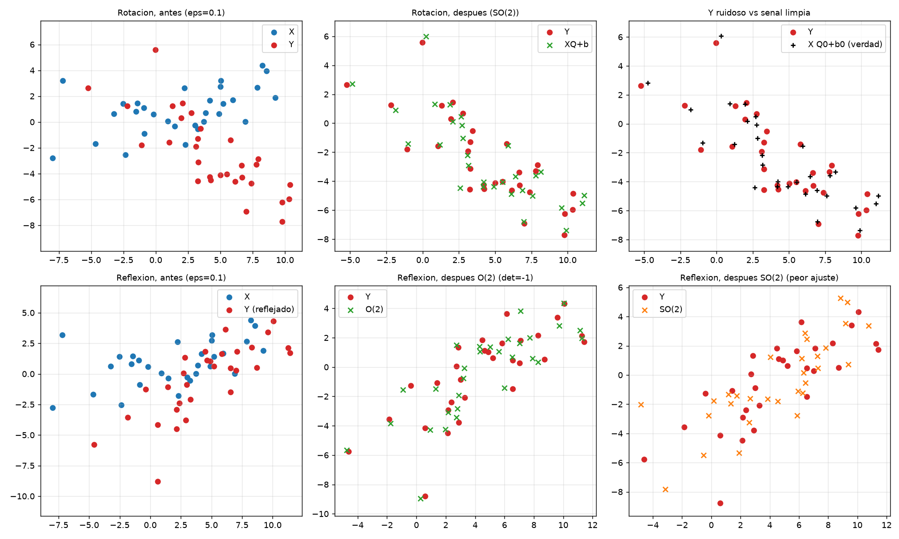
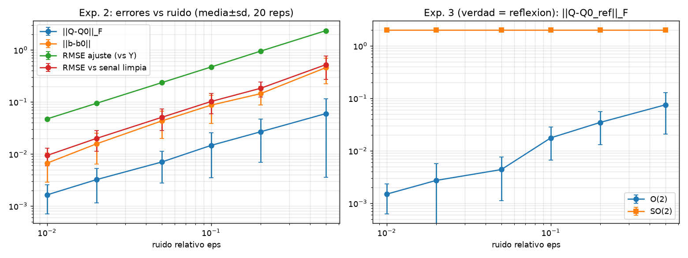
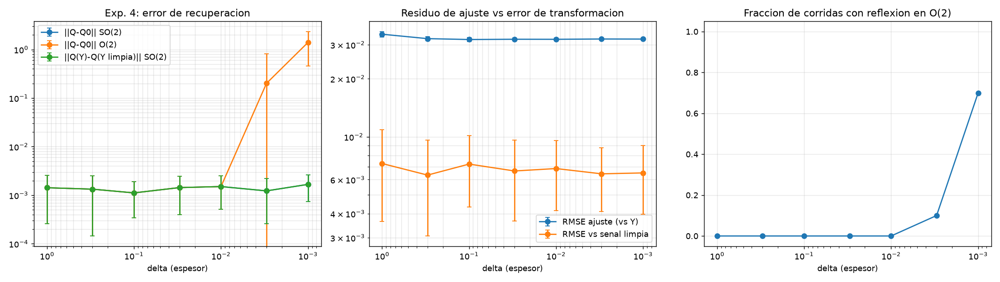
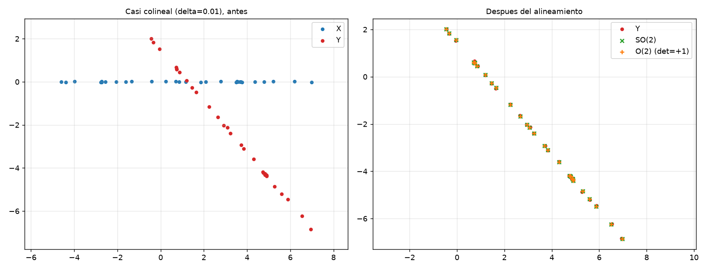

# Recuperación de transformaciones rígidas bidimensionales bajo ruido mediante Procrustes ortogonal

**Tema asignado:** Alineamiento de configuraciones mediante Procrustes

**Estado del trabajo:** Entrega final (etiqueta: `entrega-final`). La versión de la entrega parcial está en la etiqueta `avance-parcial`.

## Integrantes

* Clara Jimena Palma Dolmos
* Yanira Thais Sanchez Cárdenas
* Daniel Alejandro Seas Ordinola
* Alyssa Antuanette Trujillo Cruzado

## Problema

El problema consiste en recuperar analíticamente una transformación rígida (rotación y traslación) que alinee dos conjuntos de puntos correspondientes, y determinar la confiabilidad de este ajuste matemático cuando los datos originales presentan ruido o direcciones poco observables.

## Objetivo

Formular y demostrar matemáticamente la solución del problema de Procrustes mediante la descomposición en valores singulares (SVD) para minimizar la discrepancia cuadrática medida en norma de Frobenius. Adicionalmente, implementar esta solución en Python para contrastar el error de ajuste geométrico frente al error real de recuperación de parámetros.

## Alcance

**Incluido**

* Dimensión $`p = 2`$, con correspondencia conocida entre puntos (la fila $`i`$ de $`X`$ se compara con la fila $`i`$ de $`Y`$).
* Transformaciones rígidas: rotación, reflexión y traslación. La traslación se elimina centrando los datos; no se estima escala ($`s = 1`$).
* Comparación entre la solución sobre $`O(2)`$ (rotaciones y reflexiones) y sobre $`SO(2)`$ (solo rotaciones propias).
* Experimentos con datos sintéticos (30 puntos, semilla fija) para estudiar el efecto del ruido y de la casi colinealidad sobre el error de ajuste y el error de recuperación de la transformación.
* Verificación numérica de la teoría: ortogonalidad de $`Q`$, fórmula del costo mínimo, diferencia de costos $`4\sigma_2(M)`$ entre $`SO(2)`$ y $`O(2)`$, y comparación con `scipy.linalg.orthogonal_procrustes` [[6]](docs/fuentes.md#ref6).
* Simulación auxiliar de 400 repeticiones por combinación para el criterio relativo $`r=\sigma_2(X_c)/s`$ (ver [§5.4 de la interpretación](docs/Interpretacion_resultados.md#s5-4)).

**Fuera del alcance**

* Escala, y dimensiones mayores que 2.
* Procrustes generalizado (varias configuraciones), pesos por punto o coordenada, datos faltantes y pérdidas robustas.
* Correspondencias desconocidas (Procrustes–Wasserstein [[4]](docs/fuentes.md#ref4)) y optimización sobre variedades.
* Datos reales: todos los experimentos usan datos generados por el código.

## Organización de archivos

Los archivos correspondientes a esta entrega se estructuran de la siguiente manera:

```
├── README.md
├── requirements.txt
├── src/
│   ├── experimentos_procrustes.py
│   └── simulacion_criterio_relativo.py
├── results/
│   ├── resultados.txt
│   ├── puntos_X.csv
│   ├── exp2_rotacion_resumen.csv      (y exp2_rotacion_corridas.csv)
│   ├── exp3_reflexion_resumen.csv     (y exp3_reflexion_corridas.csv)
│   ├── exp4_colineal_resumen.csv      (y exp4_colineal_corridas.csv)
│   ├── simulacion_criterio_relativo.csv
│   └── fig1 … fig4 (.png)
└── docs/
    ├── desarrollo_matematico.md
    ├── Interpretacion_resultados.md
    ├── guion_video.md
    ├── fuentes.md
    ├── contribuciones.md
    └── uso_ia.md
```

* [`src/`](src/): scripts de Python. [`experimentos_procrustes.py`](src/experimentos_procrustes.py) contiene el algoritmo y los experimentos; [`simulacion_criterio_relativo.py`](src/simulacion_criterio_relativo.py) contiene la simulación auxiliar (importa el módulo anterior, por lo que ambos deben estar en la misma carpeta).
* [`results/`](results/): archivos generados por el código (tablas `.csv`, gráficos `.png` y el registro [`resultados.txt`](results/resultados.txt)). Se incluyen ya generados para poder revisarlos sin ejecutar nada; ejecutar los scripts los regenera con el mismo contenido (semilla fija).
* [`requirements.txt`](requirements.txt): dependencias y versiones exactas necesarias para la ejecución.
* [`docs/`](docs/): [desarrollo matemático](docs/desarrollo_matematico.md), [interpretación de resultados](docs/Interpretacion_resultados.md), [guion del video](docs/guion_video.md), [fuentes en formato IEEE](docs/fuentes.md), [registro de contribuciones](docs/contribuciones.md) y [declaración de uso de IA](docs/uso_ia.md).

## Instrucciones de ejecución

**Requisitos:** Python 3.14.5 (versión con la que se obtuvieron los resultados) y las bibliotecas de [`requirements.txt`](requirements.txt) (NumPy [[5]](docs/fuentes.md#ref5), Matplotlib y SciPy [[6]](docs/fuentes.md#ref6), con sus versiones).

1. Descargar o clonar el repositorio y abrir una terminal en la carpeta raíz.
2. Instalar las dependencias:

```
pip install -r requirements.txt
```

3. Entrar a la carpeta de resultados y ejecutar el script desde ahí (los archivos se generan en la carpeta desde la que se ejecuta):

```
cd results
python ../src/experimentos_procrustes.py
```

(En Windows PowerShell, escribir cada comando en su propia línea.)

4. Opcional: volver a la raíz y ejecutar la simulación auxiliar (400 repeticiones por combinación; escribe en `results/` por sí misma):

```
cd ..
python src/simulacion_criterio_relativo.py
```

El primer programa tarda unos segundos, imprime los resultados en pantalla y regenera en `results/`: `resultados.txt`, los archivos `.csv` y las figuras `fig1` a `fig4`. Como la semilla es fija (`SEED = 20261101`), el contenido debe ser idéntico al incluido en el repositorio, salvo diferencias de redondeo del orden de $ 10^{-13} $. La simulación usa su propia semilla (`1`) y genera `simulacion_criterio_relativo.csv`.

**Cómo comprobar que la ejecución es correcta** (valores esperados en [`results/resultados.txt`](results/resultados.txt)):

| Comprobación | Valor esperado |
|---|---|
| Rotación con ruido $`\varepsilon = 0.01`$: error angular | $`0.066^\circ \pm 0.038^\circ`$ |
| Rotación con ruido $`\varepsilon = 0.50`$: error angular | $`2.414^\circ \pm 2.270^\circ`$ |
| Reflexión: $`\det Q`$ en $`O(2)`$ | $`-1`$ en las 140 corridas |
| Reflexión: error máximo de la igualdad $`\text{costo}_{SO(2)} - \text{costo}_{O(2)} = 4\sigma_2`$ | $`2.842\times 10^{-13}`$ |
| Casi colineal, $`\delta = 0.001`$: reflexiones erróneas en $`O(2)`$ | 70 % |
| Comparación con SciPy: $`\lVert Q_{\text{propio}} - Q_{\text{SciPy}}\rVert_F`$ | $`0.00\times 10^{0}`$ |
| Ortogonalidad: $`\lVert Q^\top Q - I\rVert_F`$ | $`4.24\times 10^{-16}`$ |
| Costo directo frente a la fórmula $`\lVert X_c\rVert_F^2 + \lVert Y_c\rVert_F^2 - 2\sum_i\sigma_i`$ (diferencia) | $`2.03\times 10^{-13}`$ |
| Contraste con la transpuesta: $`\lVert Q - Q_0^\top\rVert_F`$ (datos exactos) | $`2.167`$ |

## Implementación y experimentos desarrollados

**1. Estructura general del código**

El archivo [`src/experimentos_procrustes.py`](src/experimentos_procrustes.py) está dividido en secciones identificadas con letras. Cada punto de la consigna tiene su lugar:

| Punto de la consigna | Sección | Funciones / elementos |
|---|---|---|
| 1. Puntos asimétricos y no colineales, semilla fija | 0 y B | `SEED`, `N`, `make_points()`, `report_points()` |
| 2. Rotación conocida y varios niveles de ruido | C | `exp2_rotacion()` |
| 3. Reflexión, $`O(2)`$ vs $`SO(2)`$, diferencia $`4\sigma_2(M)`$ | D | `exp3_reflexion()` |
| 4. Casi colinealidad: separar residuo y error | E | `make_collinear_base()`, `exp4_colineal()` |
| 5. Repeticiones, media y dispersión, figuras con ejes iguales | F y G | `REPS`, `agg()`, `save_csv()`, `eq()`, `fig1` a `fig4` |
| Núcleo común | A | `procrustes()`, `rot()`, `rng_for()`, `make_noise()`, `cost()`, `angle_deg()`, `metrics()` |
| Ejecución | H | `main()` |
| Verificaciones (SciPy, ortogonalidad, fórmula del mínimo) | H | `verificaciones()` |

La correspondencia con la teoría (los cinco pasos del algoritmo) está en la [sección 7 del desarrollo matemático](docs/desarrollo_matematico.md#sec7).

**2. Importaciones**

Se usan `csv`, `numpy`, `matplotlib` (con el backend Agg, que permite guardar figuras sin abrir ventanas) y `scipy` (solo `scipy.linalg.orthogonal_procrustes`, para la verificación con una implementación independiente).

**3. Sección 0: parámetros y semilla**

Todos los parámetros viven al inicio del archivo. La semilla `SEED = 20261101` es fija y pública. En lugar de un único generador global, `rng_for(*key)` (definida en la sección A) crea un generador independiente para cada combinación (experimento, nivel de ruido, repetición). Así cada corrida es reproducible por separado y cambiar el número de repeticiones no altera las demás.

**4. Sección A: núcleo y utilidades**

`procrustes(X, Y, solo_rotacion)` implementa los cinco pasos de la teoría (centrar, matriz de relación, SVD, evitar reflexión, traslación) y devuelve $`Q`$, $`b`$ y los valores singulares de $`M`$. Con `solo_rotacion=True` se corrige el signo del último valor singular para forzar $`\det Q = +1`$ (grupo $`SO(2)`$); con `False` se resuelve sobre $`O(2)`$. Las utilidades auxiliares son:

* `rng_for`: generador independiente por (experimento, nivel, repetición).
* `make_noise`: escala el ruido para que $`\lVert E\rVert_F = \varepsilon\,\lVert X_c\rVert_F`$ sea exacto.
* `cost`: costo cuadrado centrado.
* `angle_deg`: error angular (devuelve `nan` si los determinantes difieren).
* `metrics`: separa el residuo de ajuste (`rmse_fit`, contra $`Y`$ ruidoso) del error de recuperación (`q_err`, `b_err`, `rmse_true`, contra la verdad).

**5. Sección B: construcción de los puntos**

Se generan $`N = 30`$ puntos. Para que sean asimétricos se suma un término exponencial a la coordenada $`x`$ (sesgo) y se añade una curvatura $`0.15\,x^2/4`$ a la coordenada $`y`$. Esto rompe cualquier simetría de espejo, de modo que una reflexión no pueda confundirse con una rotación. Para comprobar que no son colineales, `report_points` imprime los valores singulares de $`X_c`$ y el cociente $`\sigma_2/\sigma_1`$, además de la asimetría (skewness) de $`x`$.

**6. Sección C: rotación con ruido**

Para cada uno de los 7 niveles de ruido y cada una de las 20 repeticiones se construye $`Y = XQ_0 + \mathbf{1}b_0^\top + E`$, se resuelve sobre $`SO(2)`$ y se guardan las métricas (error de $`Q`$, error angular, error de $`b`$, RMSE de ajuste y RMSE contra la señal limpia). El nivel 0 sirve de control: el error debe ser del orden de la precisión de máquina.

**7. Sección D: reflexión, $`O(2)`$ frente a $`SO(2)`$**

Ahora la verdad es $`Q_0^{\text{ref}} = Q_0\,\mathrm{diag}(1,-1)`$, con determinante $`-1`$. En cada corrida se resuelven los dos problemas, se calculan ambos costos y se compara $`\text{costo}_{SO(2)} - \text{costo}_{O(2)}`$ con $`4\sigma_2(M)`$, donde $`\sigma_2`$ es el segundo valor singular de $`M`$. Se registra el error absoluto de esa igualdad, que debe ser del orden de $`10^{-13}`$. Al final hay un control: con verdad = rotación, la diferencia debe ser 0.

**8. Sección E: configuraciones casi colineales**

Se construyen puntos $`X = [\,t,\ \delta\,w\,]`$, con $`t`$ en un rango amplio y $`w`$ ruido normal. Al bajar $`\delta`$ la nube se aplana sobre una recta: el cociente $`\sigma_2/\sigma_1`$ de $`X_c`$ baja de $`0.37`$ a $`0.0004`$. El ruido relativo se fija en $`0.01`$. En cada nivel se miden:

* el error de recuperación de $`Q`$ en $`SO(2)`$ y en $`O(2)`$.
* la fracción de corridas en que $`O(2)`$ devuelve una reflexión.
* la perturbación $`\lVert Q(Y) - Q(Y_{\text{limpia}})\rVert`$, es decir, cuánto se mueve $`Q`$ al agregar ruido.
* por separado, el residuo de ajuste frente al error contra la señal limpia.

**9. Sección F: repeticiones y estadística**

`agg()` calcula, para cada métrica, la media y la desviación estándar muestral (`ddof = 1`) sobre las 20 repeticiones; ignora los `nan` del error angular cuando los determinantes difieren. `save_csv()` guarda tanto las corridas individuales como los resúmenes. `P()` imprime y a la vez acumula el texto para escribirlo en `resultados.txt`.

**10. Sección G: figuras**

Todas las figuras de puntos usan `ax.set_aspect("equal")` (función `eq`), para que una rotación no se vea deformada. Se generan cuatro figuras:

* `fig1`: puntos antes y después del alineamiento (rotación y reflexión; en reflexión se compara $`O(2)`$ con $`SO(2)`$).
* `fig2`: errores contra nivel de ruido (media ± desviación sobre las repeticiones).
* `fig3`: casi colinealidad (error de recuperación, residuo frente a error de transformación, fracción de reflexiones).
* `fig4`: puntos casi colineales antes y después del alineamiento.

**11. Sección H: verificaciones y programa principal**

`verificaciones()` compara la solución con `scipy.linalg.orthogonal_procrustes` [[6]](docs/fuentes.md#ref6), comprueba la ortogonalidad de $`Q`$, la fórmula del costo mínimo, el determinante y el contraste con la transpuesta $`Q_0^\top`$. `main()` ejecuta todo en orden: genera los puntos, corre los tres experimentos, ejecuta `verificaciones()`, produce las cuatro figuras y guarda el registro completo en `resultados.txt`.

**12. Simulación auxiliar**

[`src/simulacion_criterio_relativo.py`](src/simulacion_criterio_relativo.py) reutiliza la nube casi colineal y la función `procrustes()` del módulo anterior. Recorre 4 niveles de ruido ($`\varepsilon = 0.005,\,0.01,\,0.02,\,0.05`$) por 9 espesores ($`\delta`$ de $`0.0003`$ a $`0.1`$), con 400 repeticiones por combinación, y calcula la fracción de corridas en que $`O(2)`$ devuelve una reflexión y el cociente

```math
r=\frac{\sigma_2(X_c)}{s},\qquad s=\frac{\varepsilon\,\lVert X_c\rVert_F}{\sqrt{2N}} .
```

## Resultados principales

Los experimentos usan 30 puntos sintéticos en el plano, una rotación verdadera de $`50^\circ`$ y 20 repeticiones por nivel. Se separa el **residuo de ajuste** (contra los datos con ruido) del **error de recuperación** (contra la transformación verdadera). En la interpretación los experimentos se llaman A, B y C; corresponden a los Exp. 2, 3 y 4 del código, de los archivos `exp2_*`, `exp3_*`, `exp4_*` y de las figuras.

**1. Rotación con ruido ($`SO(2)`$), Experimento A.** Sin ruido, el error es de precisión de máquina ($`\sim 10^{-15}`$). Con ruido, el error angular crece casi linealmente con el nivel de ruido $`\varepsilon`$:

| $`\varepsilon`$ | Error angular (°) | RMSE de ajuste | RMSE vs señal limpia |
|---|---|---|---|
| 0.01 | $`0.066 \pm 0.038`$ | 0.0472 | 0.0094 |
| 0.10 | $`0.592 \pm 0.451`$ | 0.4692 | 0.1019 |
| 0.20 | $`1.079 \pm 0.801`$ | 0.9449 | 0.1825 |
| 0.50 | $`2.414 \pm 2.270`$ | 2.341 | 0.519 |

Datos: [`exp2_rotacion_resumen.csv`](results/exp2_rotacion_resumen.csv) y [`exp2_rotacion_corridas.csv`](results/exp2_rotacion_corridas.csv). Detalle en [§3 de la interpretación](docs/Interpretacion_resultados.md#s3).

**2. Reflexión: $`O(2)`$ frente a $`SO(2)`$, Experimento B.** Cuando la transformación verdadera es una reflexión, $`O(2)`$ la detecta siempre ($`\det Q = -1`$ en las 140 corridas). Forzar $`SO(2)`$ aumenta el costo cuadrático en exactamente $`4\sigma_2(M)`$; el error máximo de esa igualdad fue $`2.8\times 10^{-13}`$. Con verdad = rotación, la diferencia de costos es $`0`$. Datos: [`exp3_reflexion_resumen.csv`](results/exp3_reflexion_resumen.csv) y [`exp3_reflexion_corridas.csv`](results/exp3_reflexion_corridas.csv). Detalle en [§4 de la interpretación](docs/Interpretacion_resultados.md#s4).

**3. Puntos casi colineales, Experimento C.** Al reducir el espesor $`\delta`$ de la nube, $`\sigma_2(M)`$ baja de $`43`$ a $`\approx 10^{-4}`$ y el residuo de ajuste se mantiene constante ($`\approx 0.032`$). Sin embargo, en $`O(2)`$ la fracción de reflexiones erróneas sube a 10 % ($`\delta = 0.003`$) y 70 % ($`\delta = 0.001`$), con error de recuperación de $`0.20`$ y $`1.40`$; en $`SO(2)`$ el error se mantiene en $`\approx 1.5\times 10^{-3}`$. **Un buen ajuste no garantiza identificar la transformación.** Datos: [`exp4_colineal_resumen.csv`](results/exp4_colineal_resumen.csv) y [`exp4_colineal_corridas.csv`](results/exp4_colineal_corridas.csv). Detalle en [§5 de la interpretación](docs/Interpretacion_resultados.md#s5).

Con 20 repeticiones cada corrida pesa 5 puntos porcentuales, así que esos porcentajes son poco estables; la simulación auxiliar (400 repeticiones) da $`\approx 19\,\%`$ para $`\delta = 0.003`$ y $`\approx 42\,\%`$ para $`\delta = 0.001`$.

**4. Simulación auxiliar: criterio relativo $`r`$.** La frecuencia de reflexiones erróneas en $`O(2)`$ depende de $`r = \sigma_2(X_c)/s`$ y no de $`\delta`$ ni de $`\varepsilon`$ por separado:

| $`r`$ | Fracción de reflexiones erróneas en $`O(2)`$ |
|---|---|
| $`< 0.3`$ | 40–50 % |
| $`0.5 – 1`$ | 20–30 % |
| $`1 – 2`$ | 4–16 % |
| $`\ge 3`$ | $`\approx 0\,\%`$ |

Datos: [`simulacion_criterio_relativo.csv`](results/simulacion_criterio_relativo.csv). Detalle en [§5.4 de la interpretación](docs/Interpretacion_resultados.md#s5-4).

**5. Verificaciones** (sección `VERIFICACIONES` de [`resultados.txt`](results/resultados.txt)). La solución propia coincide con `scipy.linalg.orthogonal_procrustes` (diferencia $`0`$), cumple $`\lVert Q^\top Q - I\rVert_F \approx 4\times 10^{-16}`$, su costo coincide con la fórmula $`\lVert X_c\rVert_F^2 + \lVert Y_c\rVert_F^2 - 2\sum_i\sigma_i`$ (diferencia $`\approx 2\times 10^{-13}`$) y, con datos exactos, $`\lVert Q - Q_0\rVert_F \approx 7\times 10^{-16}`$ mientras $`\lVert Q - Q_0^\top\rVert_F = 2.167`$ (no devuelve la transpuesta). Detalle en [§2 de la interpretación](docs/Interpretacion_resultados.md#s2).

Figuras (en [`results/`](results/)):


*Figura 1 ([`fig1_puntos_antes_despues.png`](results/fig1_puntos_antes_despues.png)): puntos antes y después del alineamiento.*


*Figura 2 ([`fig2_errores_vs_ruido.png`](results/fig2_errores_vs_ruido.png)): errores frente al nivel de ruido.*


*Figura 3 ([`fig3_casi_colineal.png`](results/fig3_casi_colineal.png)): casi colinealidad.*


*Figura 4 ([`fig4_colineal_puntos.png`](results/fig4_colineal_puntos.png)): puntos casi colineales antes y después.*

El desarrollo matemático completo está en [`docs/desarrollo_matematico.md`](docs/desarrollo_matematico.md) y las tablas e interpretación detallada en [`docs/Interpretacion_resultados.md`](docs/Interpretacion_resultados.md).

## Referencias

Lista completa en formato IEEE en [`docs/fuentes.md`](docs/fuentes.md), con la parte del trabajo en que se usa cada una: [[1]](docs/fuentes.md#ref1), [[2]](docs/fuentes.md#ref2), [[3]](docs/fuentes.md#ref3), [[4]](docs/fuentes.md#ref4), [[5]](docs/fuentes.md#ref5), [[6]](docs/fuentes.md#ref6), [[7]](docs/fuentes.md#ref7), [[8]](docs/fuentes.md#ref8).

## Uso de inteligencia artificial

Declaración completa en [`docs/uso_ia.md`](docs/uso_ia.md) (herramienta, versión, finalidad, instrucciones relevantes, partes asistidas y cómo se verificó lo obtenido).

## Contribuciones

El registro de contribuciones de cada integrante está en [`docs/contribuciones.md`](docs/contribuciones.md).

## Enlace al video

Video final: _(pendiente; se agregará en la entrega final)_. El guion está en [`docs/guion_video.md`](docs/guion_video.md).
