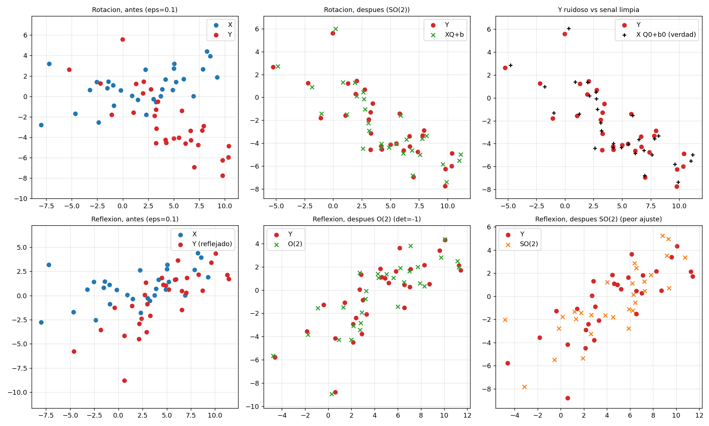
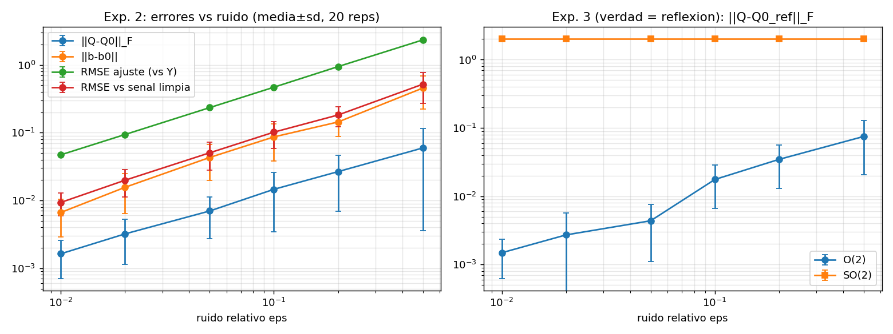
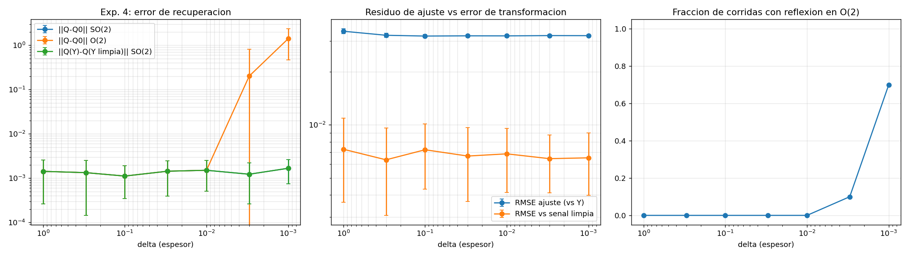
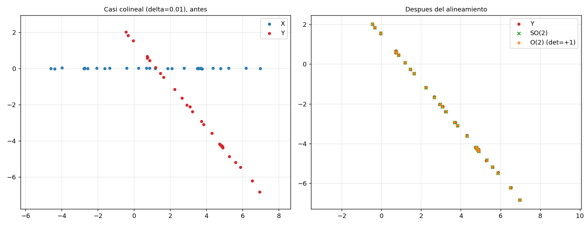

# Recuperación de transformaciones rígidas bidimensionales bajo ruido mediante Procrustes ortogonal

**Tema asignado:** Alineamiento de configuraciones mediante Procrustes

**Estado del trabajo:** Entrega Parcial (etiqueta: `avance-parcial`)

## Integrantes
* Clara Jimena Palma Dolmos
* Yanira Thais Sanchez Cárdenas
* Daniel Alejandro Seas Ordinola
* Alyssa Antuanette Trujillo Cruzado

## Problema
El problema consiste en recuperar analíticamente una transformación rígida (rotación y traslación) que alinee dos conjuntos de puntos correspondientes, y determinar la confiabilidad de este ajuste matemático cuando los datos originales presentan ruido o direcciones poco observables.

## Objetivo
Formular y demostrar matemáticamente la solución del problema de Procrustes mediante la descomposición en valores singulares (SVD) para minimizar la discrepancia cuadrática medida en norma de Frobenius. Adicionalmente, implementar esta solución en Python para contrastar el error de ajuste geométrico frente al error real de recuperación de parámetros.

## Alcance

**Incluido**
* Dimensión p = 2, con correspondencia conocida entre puntos (la fila *i* de X se compara con la fila *i* de Y).
* Transformaciones rígidas: rotación, reflexión y traslación. La traslación se elimina centrando los datos; no se estima escala (s = 1).
* Comparación entre la solución sobre O(2) (rotaciones y reflexiones) y sobre SO(2) (solo rotaciones propias).
* Experimentos con datos sintéticos (30 puntos, semilla fija) para estudiar el efecto del ruido y de la casi colinealidad sobre el error de ajuste y el error de recuperación de la transformación.
* Verificación numérica de la teoría: ortogonalidad de Q, fórmula del costo mínimo, diferencia de costos 4σ₂(M) entre SO(2) y O(2), y comparación con `scipy.linalg.orthogonal_procrustes`.

**Fuera del alcance**
* Escala, y dimensiones mayores que 2.
* Procrustes generalizado (varias configuraciones), pesos por punto o coordenada, datos faltantes y pérdidas robustas.
* Correspondencias desconocidas (Procrustes–Wasserstein) y optimización sobre variedades.
* Datos reales: todos los experimentos usan datos generados por el código.

## Organización de archivos

Los archivos correspondientes a esta entrega se estructuran de la siguiente manera:

```
├── README.md
├── requirements.txt
├── src/
│   └── experimentos_procrustes.py
├── results/
│   ├── resultados.txt
│   ├── puntos_X.csv
│   ├── exp2_rotacion_resumen.csv      (y exp2_rotacion_corridas.csv)
│   ├── exp3_reflexion_resumen.csv     (y exp3_reflexion_corridas.csv)
│   ├── exp4_colineal_resumen.csv      (y exp4_colineal_corridas.csv)
│   └── fig1 … fig4 (.png)
└── docs/
    └── (documentos PDF y uso_ia.md)
```

- `src/`: contiene el script principal de Python con el algoritmo y los experimentos.
- `results/`: archivos generados por el código (tablas `.csv`, gráficos `.png` y el registro `resultados.txt`). Se incluyen ya generados para poder revisarlos sin ejecutar nada; ejecutar el script los regenera con el mismo contenido (semilla fija).
- `requirements.txt`: dependencias y versiones exactas necesarias para la ejecución.
- `docs/`: Documento PDF con el desarrollo matemático completo, interpretación de resultados y guion del video.

## Instrucciones de ejecución

**Requisitos:** Python 3.14.5 (versión con la que se obtuvieron los resultados) y las bibliotecas de `requirements.txt` (NumPy, Matplotlib y SciPy, con sus versiones).

1. Descargar o clonar el repositorio y abrir una terminal en la carpeta raíz.
2. Instalar las dependencias:

```
pip install -r requirements.txt
```

3. Entrar a la carpeta de resultados y ejecutar el script desde ahí (los archivos se generan en la carpeta desde la que se ejecuta):

```
cd results
python ../src/experimentos_procrustes.py
```

(En Windows PowerShell, escribir cada comando en su propia línea.)

El programa tarda unos segundos, imprime los resultados en pantalla y regenera en `results/`: `resultados.txt`, los archivos `.csv` y las figuras `fig1` a `fig4`. Como la semilla es fija (`SEED = 20261101`), el contenido debe ser idéntico al incluido en el repositorio, salvo diferencias de ~1e-16 en valores que valen cero.

**Cómo comprobar que la ejecución es correcta** (valores esperados en `resultados.txt`):

| Comprobación | Valor esperado |
|---|---|
| Rotación con ruido ε = 0.01: error angular | 0.066° ± 0.038° |
| Rotación con ruido ε = 0.50: error angular | 2.414° ± 2.270° |
| Reflexión: det Q en O(2) | −1 en las 140 corridas |
| Reflexión: máx. \|(costo_SO2 − costo_O2) − 4σ₂\| | 2.842e-13 |
| Casi colineal, δ = 0.001: reflexiones erróneas en O(2) | 70 % |
| Comparación con SciPy: ‖Q propio − Q SciPy‖ | 0.00e+00 |

## Implementación y experimentos desarrollados

**1. Estructura general del código**

El archivo Experimentos de Procrustres octogonal en el plano.py está dividido en secciones identificadas con letras. Cada punto de la consigna tiene su lugar:

| Punto de la consigna | Sección | Funciones / elementos |
|---|---|---|
| 1. Puntos asimétricos y no colineales, semilla fija | 0 y B | SEED, N, make_points(), report_points() |
| 2. Rotación conocida y varios niveles de ruido | C | exp2_rotacion() |
| 3. Reflexión, O(2) vs SO(2), diferencia 4σ₂(M) | D | exp3_reflexion() |
| 4. Casi colinealidad: separar residuo y error | E | make_collinear_base(), exp4_colineal() |
| 5. Repeticiones, media y dispersión, figuras con ejes iguales | F y G | REPS, agg(), save_csv(), eq(), fig1 a fig4 |
| Núcleo común | A | procrustes(), rot(), rng_for(), make_noise(), cost(), angle_deg(), metrics() |
| Ejecución | H | main() |


**2. Importaciones**

Se usan solo csv, numpy y matplotlib (con el backend Agg, que permite guardar figuras sin abrir ventanas).


**3. Sección 0: parámetros y semilla**

Todos los parámetros viven al inicio del archivo. La semilla `SEED = 20261101` es fija y pública. En lugar de un único generador global, `rng_for(*key)` (definida en la sección A) crea un generador independiente para cada combinación (experimento, nivel de ruido, repetición). Así cada corrida es reproducible por separado y cambiar el número de repeticiones no altera las demás.


**4. Sección A: núcleo y utilidades**

`procrustes(X, Y, solo_rotacion)` implementa los cinco pasos de la teoría (centrar, matriz de relación, SVD, evitar reflexión, traslación) y devuelve Q, b y los valores singulares de M. Con `solo_rotacion=True` se corrige el signo del último valor singular para forzar `det(Q) = +1` (grupo SO(2)); con False se resuelve sobre O(2).
Las utilidades auxiliares son:
* `rng_for`: generador independiente por (experimento, nivel, repetición).
* `make_noise`: escala el ruido para que ‖E‖_F = ε‖Xc‖_F sea exacto.
* `cost`: costo cuadrado centrado.
* `angle_deg`: error angular (devuelve nan si los determinantes difieren).
* `metrics`: separa el residuo de ajuste (rmse_fit, contra Y ruidoso) del error de recuperación (q_err, b_err, rmse_true, contra la verdad).
        
        
**5. Sección B: construcción de los puntos** 

Se generan N = 30 puntos. Para que sean asimétricos se suma un término exponencial a la coordenada x (sesgo) y se añade una curvatura 0.15· x²/4 a la coordenada y. Esto rompe cualquier simetría de espejo, de modo que una reflexión no pueda confundirse con una rotación. Para comprobar que no son colineales, report_points imprime los valores singulares de Xc y el cociente s₂/s₁, además de la asimetría (skewness) de x.


**6. Sección C: rotación con ruido**

Para cada uno de los 7 niveles de ruido y cada una de las 20 repeticiones se construye `Y = X Q0 + b0 + E`, se resuelve sobre SO(2) y se guardan las métricas (error de Q, error angular, error de b, RMSE de ajuste y RMSE contra la señal limpia). El nivel 0 sirve de control: el error debe ser del orden de la precisión de máquina


**7. Sección D: reflexión, O(2) frente a SO(2)**

Ahora la verdad es `Q0_ref = Q0·diag(1, −1)`, con determinante −1. En cada corrida se resuelven los dos problemas, se calculan ambos costos y se compara `costo_SO2 − costo_O2` con 4·σ₂(M), donde σ₂ es el segundo valor singular de M. Se registra el error absoluto de esa igualdad, que debe ser del orden de 1e-13. Al final hay un control: con verdad = rotación, la diferencia debe ser 0.


**8. Sección E: configuraciones casi colineales**

Se construyen puntos `X = [t, δ·w]`, con t en un rango amplio y w ruido normal. Al bajar δ la nube se aplana sobre una recta: el cociente s₂/s₁ de Xc baja de 0.37 a 0.0004. El ruido relativo se fija en 0.01. En cada nivel se miden:

* el error de recuperación de Q en SO(2) y en O(2).
* la fracción de corridas en que O(2) devuelve una reflexión.
* la perturbación ‖Q(Y) − Q(Y limpia)‖, es decir, cuánto se mueve Q al agregar ruido.
* por separado, el residuo de ajuste frente al error contra la señal limpia.


**9. Sección F: repeticiones y estadística**

`agg()` calcula, para cada métrica, la media y la desviación estándar muestral (`ddof = 1`) sobre las 20 repeticiones; ignora los nan del error angular cuando los determinantes difieren. `save_csv()` guarda tanto las corridas individuales como los resúmenes. `P()` imprime y a la vez acumula el texto para escribirlo en resultados.txt.


**10. Sección G: figuras**

Todas las figuras de puntos usan ax.set_aspect("equal") (función eq), para que una rotación no se vea deformada. Se generan cuatro figuras:
        
* `fig1`: puntos antes y después del alineamiento (rotación y reflexión; en reflexión se compara O(2) con SO(2)).
* `fig2`: errores contra nivel de ruido (media ± desviación sobre las repeticiones).
* `fig3`: casi colinealidad (error de recuperación, residuo frente a error de transformación, fracción de reflexiones).
* `fig4`: puntos casi colineales antes y después del alineamiento.
        

**11. Sección H: programa principal**

`main()` ejecuta todo en orden: genera los puntos, corre los tres experimentos con sus repeticiones, produce las cuatro figuras y guarda el registro completo en resultados.txt.


## Resultados principales

Los experimentos usan 30 puntos sintéticos en el plano, una rotación verdadera de 50° y 20 repeticiones por nivel. Se separa el **residuo de ajuste** (contra los datos con ruido) del **error de recuperación** (contra la transformación verdadera).

**1. Rotación con ruido (SO(2)).** Sin ruido, el error es de precisión de máquina (~1e-15). Con ruido, el error angular crece casi linealmente con el nivel de ruido ε:

| ε | Error angular (°) | RMSE de ajuste | RMSE vs señal limpia |
|---|---|---|---|
| 0.01 | 0.066 ± 0.038 | 0.0472 | 0.0094 |
| 0.10 | 0.592 ± 0.451 | 0.4692 | 0.1019 |
| 0.20 | 1.079 ± 0.801 | 0.9449 | 0.1825 |
| 0.50 | 2.414 ± 2.270 | 2.341 | 0.519 |

**2. Reflexión: O(2) frente a SO(2).** Cuando la transformación verdadera es una reflexión, O(2) la detecta siempre (det = −1 en las 140 corridas). Forzar SO(2) aumenta el costo cuadrático en exactamente 4σ₂(M); el error máximo de esa igualdad fue 2.8e-13. Con verdad = rotación, la diferencia de costos es 0.

**3. Puntos casi colineales.** Al reducir el espesor δ de la nube, σ₂(M) baja de 43 a ≈1e-4 y el residuo de ajuste se mantiene constante (≈0.032). Sin embargo, en O(2) la fracción de reflexiones erróneas sube a 10 % (δ = 0.003) y 70 % (δ = 0.001), con error de recuperación de 0.20 y 1.40; en SO(2) el error se mantiene en ≈1.5e-3. **Un buen ajuste no garantiza identificar la transformación.**

**4. Verificaciones.** La solución propia coincide con `scipy.linalg.orthogonal_procrustes` (diferencia 0.00e+00), cumple ‖QᵀQ − I‖ ≈ 4e-16 y su costo coincide con la fórmula ‖Xc‖² + ‖Yc‖² − 2Σσᵢ (diferencia ≈ 2e-13).

Figuras (en `results/`):






El desarrollo matemático completo, las tablas y la interpretación están en [`docs/avance_parcial.pdf`](docs/avance_parcial.pdf).

## Referencias

Las fuentes están citadas en formato IEEE en `docs/`.

## Uso de inteligencia artificial

Declaración completa en `docs/uso_ia.md` (herramienta, versión, finalidad, instrucciones relevantes, partes asistidas y cómo se verificó lo obtenido).

## Contribuciones

El registro de contribuciones de cada integrante está en `docs/`.

## Enlace al video

Video final: _(pendiente; se agregará en la entrega final)_
