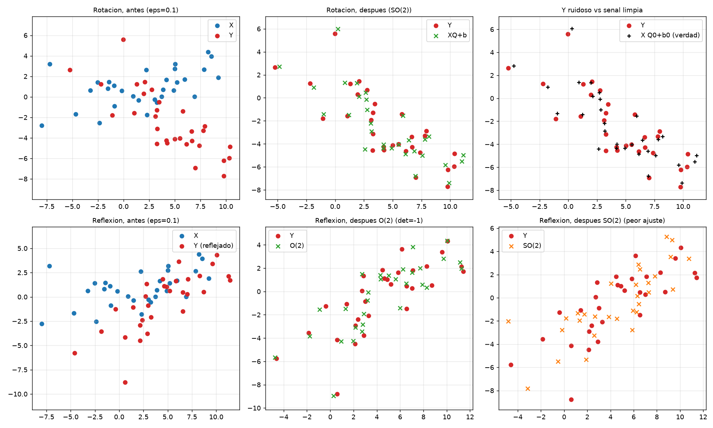
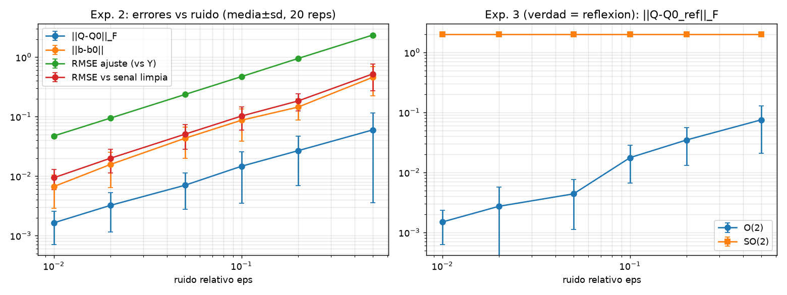
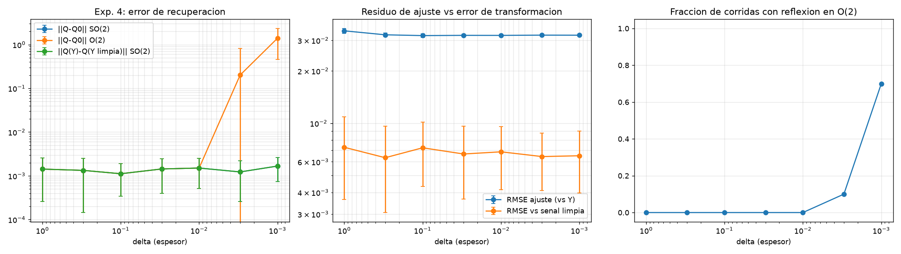
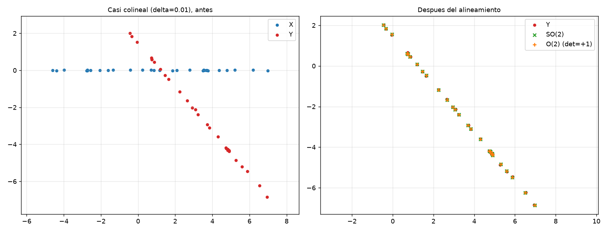

## Interpretación detallada de los resultados

**Proyecto:** Recuperación de transformaciones rígidas bidimensionales bajo ruido mediante Procrustes ortogonal

**Curso:** Álgebra Lineal Aplicada 2026-2

**Estado:** Entrega final (`entrega-final`)

**Integrantes:** Clara Jimena Palma Dolmos, Yanira Thais Sanchez Cárdenas, Daniel Alejandro Seas Ordinola, Alyssa Antuanette Trujillo Cruzado

> Todas las cifras de este documento salen de ejecutar [`src/experimentos_procrustes.py`](../src/experimentos_procrustes.py) (semilla fija `SEED = 20261101`) y [`src/simulacion_criterio_relativo.py`](../src/simulacion_criterio_relativo.py) (semilla `1`), y coinciden con [`results/resultados.txt`](../results/resultados.txt), [`results/simulacion_criterio_relativo.csv`](../results/simulacion_criterio_relativo.csv) y los demás CSV de [`results/`](../results/). La teoría que se cita está en el [desarrollo matemático](desarrollo_matematico.md).

## Índice

1. [Cómo leer los resultados](#s1)
2. [Verificaciones de la implementación](#s2)
3. [Experimento A: rotación con ruido](#s3)
4. [Experimento B: reflexión, O(2) frente a SO(2)](#s4)
5. [Experimento C: puntos casi colineales](#s5)
6. [Lectura conjunta](#s6)
7. [Limitaciones](#s7)
8. [Conclusiones](#s8)
9. [Preguntas de defensa](#s9)
10. [Cómo reproducir](#s10)

---

<a id="s1"></a>

## 1. Cómo leer los resultados

Hay dos preguntas distintas:

1. ¿Qué tan bien **encaja** la transformación estimada con los datos observados? Se mide con el **residuo de ajuste** y se puede calcular siempre.
2. ¿Qué tan cerca está la transformación estimada de la **verdadera**? Se mide con el **error de recuperación** y solo se puede calcular en una simulación, porque se conoce la respuesta correcta.

> **Idea central del proyecto:** un buen ajuste (pregunta 1) no garantiza una buena recuperación (pregunta 2).

<a id="s1-1"></a>

### 1.1 Diseño común de los experimentos

- **Datos sintéticos:** N = 30 puntos en el plano, con semilla fija (`SEED = 20261101`); la nube base se guarda en [`results/puntos_X.csv`](../results/puntos_X.csv). Como Y se construye con una transformación conocida, se puede medir cuánto se equivoca el método.
- **Transformación verdadera:** rotación Q₀ de 50° y traslación b₀ = (2.5, −1.5). En el Experimento B la verdad es la reflexión Q₀·diag(1, −1).
- **Ruido:** matriz E gaussiana normalizada para que $`\lVert E\rVert_F = \varepsilon\,\lVert X_c\rVert_F`$. Así ε es un ruido *relativo*: ε = 0.10 significa que el ruido tiene el 10 % de la norma de la nube centrada.
- **Repeticiones:** 20 por nivel en los experimentos A, B y C, cada una con su propio generador aleatorio (reproducible por separado), y 400 por combinación en la simulación auxiliar ([§5.4](#s5-4)). Se reporta media ± desviación estándar.
- **Algoritmo:** se centran X e Y, se calcula la SVD de $`M = X_c^\top Y_c`$ y se toma $`Q = UV^\top`$ (en O(2)) [[1]](fuentes.md#ref1) o $`Q = UDV^\top`$ con $`D=\mathrm{diag}(1, \det(UV^\top))`$ (en SO(2)), que es el algoritmo de Kabsch–Umeyama [[2]](fuentes.md#ref2), [[3]](fuentes.md#ref3). La traslación es $`b = \bar y - Q^\top \bar x`$. Está implementado en la función `procrustes()` de [`src/experimentos_procrustes.py`](../src/experimentos_procrustes.py); detalles en el [desarrollo matemático](desarrollo_matematico.md#sec7).
- **Implementación:** Python con NumPy [[5]](fuentes.md#ref5) para el álgebra lineal y SciPy [[6]](fuentes.md#ref6) solo para la comparación de la [sección 2](#s2). El código está en [`src/experimentos_procrustes.py`](../src/experimentos_procrustes.py) (experimentos A, B y C, verificaciones y figuras) y [`src/simulacion_criterio_relativo.py`](../src/simulacion_criterio_relativo.py) (simulación auxiliar).

**Hipótesis que se ponen a prueba**

- **H1.** Con una nube bien condicionada, el error de recuperación crece aproximadamente proporcional al ruido y es menor que el residuo de ajuste.
- **H2.** Con puntos casi colineales, el residuo de ajuste se mantiene pequeño aunque el error de recuperación crezca (en O(2), por confusión entre rotación y reflexión).
- **H3.** Forzar det Q = +1 cuando la verdad es una reflexión eleva el costo cuadrático exactamente en 4σ₂(M).
- **H4.** La frecuencia de confusiones rotación/reflexión en O(2) depende del cociente r = σ₂(Xc)/s entre el espesor de la nube y el ruido, y no de δ ni de ε por separado.

### 1.2 Métricas

| Métrica | Definición | Cómo leerla |
|---|---|---|
| RMSE de ajuste (vs Y) | `‖X̂ − Y‖_F / √N`, con X̂ = XQ + 1bᵀ y Y con ruido | Cuánto encajan los puntos con lo observado. Ni la solución perfecta baja del nivel del ruido |
| RMSE vs señal limpia | Igual, pero contra Y sin ruido | Qué tan cerca están los puntos de donde *debían* estar. Solo existe en simulación |
| Error de ángulo (°) | Ángulo de la rotación que separa Q de Q₀ | Error de recuperación de la rotación |
| `‖Q − Q₀‖_F` | Norma de Frobenius de la diferencia | Error de recuperación de la matriz completa; vale ≈ 2 si se confunde rotación con reflexión ([§4.3](#s4-3)) |
| `‖b − b₀‖` | Distancia entre traslación estimada y verdadera | Error de recuperación de la traslación |
| % de reflexiones en O(2) | Fracción de corridas con det Q = −1 cuando la verdad es rotación | Confusión rotación/reflexión |
| σ₂(M), 4σ₂(M) | Segundo valor singular de M y sobrecosto de prohibir reflexiones | Información de los datos sobre la dirección débil |
| σ₂/σ₁ de X | Cociente de valores singulares de la nube centrada | Aplanamiento de la nube (0 = puntos en una recta) |

Las métricas de ajuste y de recuperación se calculan en la función `metrics()` de [`src/experimentos_procrustes.py`](../src/experimentos_procrustes.py).

---

<a id="s2"></a>

## 2. Verificaciones numéricas de la implementación

La función `verificaciones()` de [`src/experimentos_procrustes.py`](../src/experimentos_procrustes.py) comprueba que el código resuelve el problema que dice resolver (salida completa en [`results/resultados.txt`](../results/resultados.txt)):

| Comprobación | Resultado | Qué demuestra |
|---|---|---|
| `‖Q_propia − Q_SciPy‖_F` (`scipy.linalg.orthogonal_procrustes` [[6]](fuentes.md#ref6) sobre datos centrados) | `0.00e+00` | Coincide con una implementación independiente |
| `scale` de SciPy frente a Σσᵢ de M | `687.5302607026` en ambos | `scale` no es la escala geométrica sino la suma de valores singulares |
| `‖QᵀQ − I‖_F` | `4.24e-16` | Q es ortogonal salvo redondeo (épsilon de máquina: 2.2e-16) |
| `det Q` (ruido 0.1, verdad = rotación, O(2)) | `+1.000000` | La solución es una rotación propia |
| Costo directo frente a `‖Xc‖² + ‖Yc‖² − 2Σσᵢ` | `6.826502274565` frente a `6.826502274566` (dif. `2.03e-13`) | Valida la reducción a traza y el teorema de la SVD ([desarrollo, secciones 2 y 3](desarrollo_matematico.md#sec3)) |
| Datos exactos: `‖Q − Q₀‖_F` y `‖b − b₀‖` | `7.45e-16` y `9.93e-16` | Sin ruido se recupera la transformación hasta precisión de máquina |
| Contraste: `‖Q − Q₀ᵀ‖_F` con datos exactos | `2.167` | Si el código devolviera la transpuesta, este valor sería ≈ 0 y el anterior sería 2.167 |

**Por qué el contraste con la transpuesta es informativo.** Para una rotación de ángulo θ, $`\lVert Q_0 - Q_0^\top\rVert_F = 2\sqrt2\,\sin\theta`$; con θ = 50° da 2.167. Si θ fuera 0° o 180°, Q₀ sería simétrica y la prueba no distinguiría Q de su transpuesta.

**Qué no demuestran.** Prueban que el algoritmo está bien programado, pero no cuánto se puede confiar en la transformación recuperada con ruido. Eso lo estudian los tres experimentos.

---

<a id="s3"></a>

## 3. Experimento A: rotación con ruido creciente (SO(2))

### 3.1 Qué se hizo

Se giró la nube 50° y se trasladó, se añadió ruido de nivel ε entre 0 y 0.5 y se resolvió sobre SO(2), con 20 repeticiones por nivel. Objetivo: medir cómo crece el error con el ruido (hipótesis H1). Código: función `exp2_rotacion()` de [`src/experimentos_procrustes.py`](../src/experimentos_procrustes.py).

### 3.2 Resultados

| ε | Error ángulo (°) | `‖b − b₀‖` | RMSE de ajuste (vs Y) | RMSE vs señal limpia |
|---|---|---|---|---|
| 0 | 0 | 9.9e-16 | 3.1e-15 | 3.1e-15 |
| 0.01 | 0.066 ± 0.038 | 0.0067 | 0.0472 | 0.0094 |
| 0.02 | 0.130 ± 0.084 | 0.0156 | 0.0940 | 0.0199 |
| 0.05 | 0.284 ± 0.172 | 0.0431 | 0.2346 | 0.0505 |
| 0.10 | 0.592 ± 0.451 | 0.0867 | 0.4692 | 0.1019 |
| 0.20 | 1.079 ± 0.801 | 0.144 | 0.9449 | 0.1825 |
| 0.50 | 2.414 ± 2.270 | 0.456 | 2.341 | 0.519 |

**Datos:** resumen por nivel de ruido en [`exp2_rotacion_resumen.csv`](../results/exp2_rotacion_resumen.csv) y corridas individuales en [`exp2_rotacion_corridas.csv`](../results/exp2_rotacion_corridas.csv).


*Figura 1 ([`fig1_puntos_antes_despues.png`](../results/fig1_puntos_antes_despues.png)): nube antes y después del alineamiento.*


*Figura 2 ([`fig2_errores_vs_ruido.png`](../results/fig2_errores_vs_ruido.png)), panel izquierdo: los errores del Experimento A crecen en paralelo con el ruido.*

### 3.3 Interpretación

1. **Sin ruido el método es exacto.** Con ε = 0 los errores son del orden de 10⁻¹⁵ (precisión de máquina). Confirma las fórmulas y que el código no devuelve la transpuesta.
2. **El error crece de forma casi proporcional al ruido.** De ε = 0.01 a 0.10 (×10), el error angular se multiplica por 9 (0.066° → 0.592°). Es lo esperado en mínimos cuadrados: para ruido pequeño, un cambio pequeño en los datos produce un cambio aproximadamente lineal en la solución. Con ruidos grandes se afloja (de ε = 0.01 a 0.5, 50 veces más ruido, el error aumenta unas 37 veces) porque deja de valer la aproximación de primer orden.
3. **El tamaño del error se puede predecir.** Cada entrada del ruido tiene desviación $`s=\varepsilon\lVert X_c\rVert_F/\sqrt{2N}`$. Un punto a distancia $`r_i`$ del centro informa sobre el ángulo mediante el ruido perpendicular a su radio, con información total $`\sum r_i^2/s^2=\lVert X_c\rVert_F^2/s^2`$. Entonces la desviación típica del error angular es aproximadamente

   ```math
   \sigma_\theta \approx \frac{\varepsilon}{\sqrt{2N}}\ \text{rad}\ \approx\ 7.4^\circ\cdot\varepsilon \quad (N=30).
   ```

   La tabla siguiente lo compara con lo observado (raíz de media² + desviación²) y coincide dentro de un 10 %. Es un contraste de orden de magnitud; no forma parte del desarrollo formal.

   | ε | Observado (°) | Predicho 7.4·ε (°) | Cociente |
   |---|---|---|---|
   | 0.01 | 0.076 | 0.074 | 1.03 |
   | 0.02 | 0.155 | 0.148 | 1.05 |
   | 0.05 | 0.332 | 0.370 | 0.90 |
   | 0.10 | 0.744 | 0.740 | 1.01 |
   | 0.20 | 1.344 | 1.479 | 0.91 |
   | 0.50 | 3.314 | 3.698 | 0.90 |

4. **El residuo de ajuste solo refleja el ruido.** El RMSE de ajuste vale ≈ ε·‖Xc‖_F/√N = 4.82·ε (0.0472 para ε = 0.01; 2.341 para ε = 0.5): es el ruido inyectado, que ninguna transformación rígida puede eliminar. No dice si la transformación está bien recuperada.
5. **El error contra la señal limpia es unas 5 veces menor que el residuo.** El cociente está entre 4.5 y 5.2 en todos los niveles. Solo se estiman 3 parámetros (ángulo y dos coordenadas de b) con 2N = 60 coordenadas de datos, por lo que el error contra la señal limpia es del orden de √(3/57) ≈ 0.23 del residuo (un factor ≈ 1/4.4). El método filtra la mayor parte del ruido.
6. **La traslación acompaña a la rotación.** `‖b − b₀‖` crece con ε. Parte viene del error angular: como $`b = \bar y - Q^\top\bar x`$, un error ΔQ produce un error $`-\Delta Q^\top\bar x`$ en b, proporcional a la distancia de la nube al origen.
7. **A ruido alto la estimación es poco fiable.** Con ε = 0.5 la desviación (2.270°) casi iguala a la media (2.414°): entre corridas el error va de casi 0 a más de 5°. Ese régimen exige más repeticiones o más puntos.

> **Conclusión A.** Con estructura bien condicionada, la recuperación es estable: el error de la rotación y de la traslación crece suavemente con el ruido y es menor que el residuo. Se confirma **H1**.

---

<a id="s4"></a>

## 4. Experimento B: reflexión, O(2) frente a SO(2)

### 4.1 Qué se hizo

Datos generados con una reflexión (det Q₀ = −1). Se resolvió en O(2) (admite reflexiones) y en SO(2) (no). Se comparó el sobrecosto de prohibir reflexiones con la predicción 4σ₂(M) (hipótesis **H3**). 7 niveles de ruido × 20 repeticiones = 140 corridas. Código: función `exp3_reflexion()` de [`src/experimentos_procrustes.py`](../src/experimentos_procrustes.py).

<a id="s4-2"></a>

### 4.2 Resultados

| ε | det Q (O(2)) | costo_SO2 − costo_O2 | 4σ₂(M) | Máx. error de la igualdad | `‖Q−Q₀ref‖` O(2) | `‖Q−Q₀ref‖` SO(2) |
|---|---|---|---|---|---|---|
| 0 | −1 | 269.600 | 269.600 | 1.1e-13 | 7.5e-16 | 2.00 |
| 0.01 | −1 | 270.208 | 270.208 | 2.3e-13 | 1.5e-3 | 2.00 |
| 0.02 | −1 | 269.183 | 269.183 | 1.7e-13 | 2.7e-3 | 2.00 |
| 0.05 | −1 | 271.259 | 271.259 | 2.8e-13 | 4.4e-3 | 2.00 |
| 0.10 | −1 | 272.777 | 272.777 | 1.7e-13 | 1.8e-2 | 2.00 |
| 0.20 | −1 | 263.148 | 263.148 | 2.8e-13 | 3.5e-2 | 2.00 |
| 0.50 | −1 | 280.626 | 280.626 | 2.8e-13 | 7.5e-2 | 2.00 |

**Datos:** [`exp3_reflexion_resumen.csv`](../results/exp3_reflexion_resumen.csv) y [`exp3_reflexion_corridas.csv`](../results/exp3_reflexion_corridas.csv).

*Panel derecho de [`fig2_errores_vs_ruido.png`](../results/fig2_errores_vs_ruido.png): O(2) crece con el ruido; SO(2) se mantiene en 2.*

<a id="s4-3"></a>

### 4.3 Interpretación

1. **O(2) detecta la reflexión en las 140 corridas** (det = −1 incluso con ε = 0.5). El sobrecosto de no admitir reflexiones, 4σ₂(M) ≈ 270, es grande: los datos "piden" una reflexión con claridad y el ruido no la cambia.
2. **La diferencia de costos coincide con 4σ₂(M).** Las columnas 3 y 4 son iguales y el error máximo de la igualdad es 2.8e-13 (precisión de máquina relativa a 270). Verifica el teorema de las rotaciones propias [[2]](fuentes.md#ref2), [[3]](fuentes.md#ref3) ([desarrollo, sección 5](desarrollo_matematico.md#sec5)): si det(UVᵀ) = −1, la traza máxima baja 2σ₂ y el costo cuadrático sube 4σ₂. El control con verdad = rotación da diferencia 0.
3. **Forzar SO(2) cuando la verdad es reflexión da un error constante de ≈ 2.** No es casualidad: $`Q_{\mathrm{SO}}=UDV^\top=(UV^\top)R`$ con $`R=V\,\mathrm{diag}(1,-1)V^\top`$, una reflexión simétrica. Entonces

   ```math
   \lVert Q_{\mathrm{SO}}-Q_0\rVert_F=\lVert R-I\rVert_F=\lVert V\,\mathrm{diag}(0,-2)V^\top\rVert_F=2,
   ```

   sin importar los datos. Entre las dos candidatas la distancia es exactamente 2; frente a la verdad es ≈ 2, porque $`Q_0`$ no coincide del todo con $`Q_{0}^{\mathrm{ref}}`$ (su error es de 10⁻³ a 10⁻¹ según el ruido, [tabla 4.2](#s4-2)). La misma cuenta explica por qué, en el Experimento C, cada confusión de O(2) cuesta ≈ 2.
4. **El error de O(2) crece con el ruido como en el Experimento A:** de 1.5e-3 (ε = 0.01) a 7.5e-2 (ε = 0.5), 50 veces más error para 50 veces más ruido.
5. **Significado práctico.** Si el problema prohíbe reflexiones pero los datos vienen de una, SO(2) no falla visiblemente: devuelve una rotación razonable. La alarma es el sobrecosto de 4σ₂ respecto de O(2).

> **Conclusión B.** Se verifica la fórmula 4σ₂(M) y se muestra que restringir a rotaciones cuando la verdad es una reflexión produce un error constante de ≈ 2, detectable por el aumento del costo.

---

<a id="s5"></a>

## 5. Experimento C: puntos casi colineales

### 5.1 Qué se hizo

Se aplanó la nube: la segunda coordenada se multiplicó por un espesor δ que bajó de 1 a 0.001, con las mismas posiciones sobre la recta y ε = 0.01 fijo. La verdad es una rotación de 50° (det Q₀ = +1). Se resolvió en SO(2) y O(2) y se midió el error de recuperación, el residuo y la fracción de corridas en que O(2) elige una reflexión (hipótesis **H2**). Código: funciones `make_collinear_base()` y `exp4_colineal()` de [`src/experimentos_procrustes.py`](../src/experimentos_procrustes.py).

### 5.2 Resultados

| δ | σ₂/σ₁ de X | σ₂(M) | `‖Q−Q₀‖` SO(2) | `‖Q−Q₀‖` O(2) | % reflexiones en O(2) | RMSE ajuste | RMSE vs limpia |
|---|---|---|---|---|---|---|---|
| 1 | 0.366 | 43.3 | 1.4e-3 | 1.4e-3 | 0 % | 0.034 | 0.0073 |
| 0.3 | 0.110 | 3.90 | 1.3e-3 | 1.3e-3 | 0 % | 0.032 | 0.0063 |
| 0.1 | 0.037 | 0.432 | 1.1e-3 | 1.1e-3 | 0 % | 0.032 | 0.0072 |
| 0.03 | 0.011 | 0.038 | 1.4e-3 | 1.4e-3 | 0 % | 0.032 | 0.0067 |
| 0.01 | 0.0037 | 3.7e-3 | 1.5e-3 | 1.5e-3 | 0 % | 0.032 | 0.0068 |
| 0.003 | 0.0011 | 5.8e-4 | 1.2e-3 | 0.20 | 10 % | 0.032 | 0.0064 |
| 0.001 | 0.0004 | 1.1e-4 | 1.7e-3 | 1.40 | 70 % | 0.032 | 0.0065 |

*σ₂(M) es el promedio sobre las corridas con ruido.*

**Datos:** [`exp4_colineal_resumen.csv`](../results/exp4_colineal_resumen.csv) y [`exp4_colineal_corridas.csv`](../results/exp4_colineal_corridas.csv).

> **Cómo leer los porcentajes.** Con 20 repeticiones por fila, cada corrida pesa 5 puntos porcentuales y la incertidumbre es grande: el **10 %** de δ = 0.003 son 2 de 20 corridas y el **70 %** de δ = 0.001 son **14 de 20**. Con 20 corridas, el intervalo de confianza al 95 % del 70 % va aproximadamente de 48 % a 86 %. La simulación auxiliar ([§5.4](#s5-4)), con 400 repeticiones para estas mismas configuraciones, da **≈ 19 %** (δ = 0.003) y **≈ 42 %** (δ = 0.001); esas son las estimaciones estables. La conclusión no cambia: el error es muy frecuente y el residuo es constante.


*Figura 3 ([`fig3_casi_colineal.png`](../results/fig3_casi_colineal.png)): error de recuperación, residuo y fracción de reflexiones.*


*Figura 4 ([`fig4_colineal_puntos.png`](../results/fig4_colineal_puntos.png)): nube casi colineal antes y después.*

<a id="s5-3"></a>

### 5.3 Interpretación

1. **Qué le pasa a los datos.** Al aplanar, σ₂/σ₁ de X baja de 0.37 a 0.0004 y σ₂(M) de 43 a ≈ 10⁻⁴: los datos casi no contienen información perpendicular a la recta. (Para δ muy pequeño, el σ₂(M) de la tabla incluye una parte aportada por el propio ruido.)
2. **El ajuste no se degrada.** El RMSE de ajuste se mantiene en 0.032 y el RMSE vs señal limpia en ≈ 0.0065 para todo δ. Los puntos transformados siempre caen sobre los datos. Mirando solo el residuo, el caso más aplanado parece tan bueno como el más favorable.
3. **SO(2) permanece estable.** `‖Q − Q₀‖` se queda en torno a 10⁻³ para todo δ y coincide con la perturbación `‖Q(Y) − Q(Y limpia)‖` ([figura 3](../results/fig3_casi_colineal.png)). Cuando la verdad es una rotación (det(UVᵀ) = +1), el costo crece al alejarse del óptimo como $`(\sigma_1+\sigma_2)\theta^2`$; como σ₁ es grande, el ángulo queda bien determinado por la dirección de la recta aunque σ₂ sea casi cero.
4. **En O(2) el problema es elegir entre dos candidatas.** Una rotación (det = +1) y una reflexión (det = −1) casi igual de buenas, con costos mínimos que difieren exactamente en 4σ₂(M). Para puntos sobre una recta, una rotación y la reflexión respecto de esa recta los mueven casi igual; solo las distingue la minúscula componente perpendicular. Cuando 4σ₂(M) es comparable con la perturbación que el ruido induce en esa componente, **el ruido decide** cuál devuelve el algoritmo.
5. **Cada confusión cuesta ≈ 2** ([sección 4.3](#s4-3)). Por eso el error medio es ≈ 2 × fracción de reflexiones: 2 × 0.10 = 0.20 (δ = 0.003) y 2 × 0.70 = 1.40 (δ = 0.001). Es una comprobación de consistencia de la tabla.
6. **Única en teoría, ambigua en la práctica.** Mientras σ₂(M) > 0 la solución en O(2) es única ([desarrollo, sección 4](desarrollo_matematico.md#sec4); [[1]](fuentes.md#ref1); Cor. 5.2 de [[8]](fuentes.md#ref8)), pero con σ₂(M) ≈ 10⁻⁴ una perturbación pequeña basta para pasar de una candidata a la otra. Es el sentido de "direcciones poco observables" del planteamiento.
7. **Por qué det Q = +1 lo resuelve.** Las candidatas tienen determinantes opuestos; exigir det Q = +1 elimina la ambigüedad. Pero solo es legítimo si se sabe de antemano que la verdad es una rotación; si no, se obtiene el error constante de ≈ 2 del Experimento B.

> **Conclusión C.** Un buen ajuste no garantiza identificar la transformación: el residuo se mantuvo en 0.032 mientras el error de O(2) se multiplicó por mil. Se confirma **H2** con el matiz de que lo que se vuelve inestable no es el ángulo sino la **elección entre rotación y reflexión**.

<a id="s5-4"></a>

### 5.4 Simulación auxiliar: criterio relativo r

**Qué se hizo.** El Experimento C varía solo δ con ε fijo, así que no permite saber si lo que importa es el espesor de la nube, el ruido o la relación entre ambos. La simulación [`src/simulacion_criterio_relativo.py`](../src/simulacion_criterio_relativo.py) importa la nube base y la función `procrustes()` de [`src/experimentos_procrustes.py`](../src/experimentos_procrustes.py) y recorre **4 niveles de ruido (ε = 0.005, 0.01, 0.02, 0.05) × 9 espesores (δ de 0.0003 a 0.1)**, con **400 repeticiones** por combinación (semilla 1). Para cada combinación calcula la fracción de corridas en que O(2) devuelve una reflexión y el cociente

```math
r=\frac{\sigma_2(M_{\mathrm{limpia}})}{s\,\sigma_2(X_c)}=\frac{\sigma_2(X_c)}{s},\qquad s=\frac{\varepsilon\lVert X_c\rVert_F}{\sqrt{2N}},
```

que mide el espesor de la nube en la dirección débil en unidades de ruido. (Sin ruido, $`M=X_c^\top X_cQ_0`$, por lo que $`\sigma_2(M)=\sigma_2(X_c)^2`$; el ruido aporta a M, en la dirección débil, una perturbación del orden de $`\sigma_2(X_c)\,s`$. El cociente compara señal y perturbación.)

**Resultados** ([`results/simulacion_criterio_relativo.csv`](../results/simulacion_criterio_relativo.csv)):

| r | Fracción de reflexiones erróneas en O(2) |
|---|---|
| < 0.3 | 40–50 % |
| 0.5 – 1 | 20–30 % |
| 1 – 2 | 4–16 % |
| ≥ 3 | ≈ 0 % |

Ejemplo: con r ≈ 0.57 se obtiene 29.5 % (ε = 0.05, δ = 0.01), 23.8 % (ε = 0.01, δ = 0.002) y 25.3 % (ε = 0.005, δ = 0.001). Son combinaciones muy distintas de ruido y espesor con casi la misma frecuencia de error.

**Interpretación.**

1. **Lo que decide es r, no δ ni ε por separado.** Combinaciones distintas con el mismo r dan frecuencias similares. Se confirma **H4**.
2. **Tres regímenes.** Con r ≳ 3, O(2) es confiable; con r ≈ 1, falla en un 10–20 % de los casos; con r ≲ 0.3, elige rotación o reflexión casi al azar (cerca de 50 %).
3. **σ₂/σ₁ no basta como diagnóstico.** Mide qué tan delgada es la nube, pero ignora el ruido: la misma nube puede dar 0 % o 50 % de errores según ε.
4. **Coherencia con el Experimento C** (ε = 0.01): δ = 0.01 da r = 2.83 (0 %), δ = 0.003 da r = 0.85 (19 %) y δ = 0.001 da r = 0.28 (42 %).
5. **Alcance.** r se justifica por orden de magnitud; la relación entre r y la frecuencia de error se obtuvo numéricamente, no con una fórmula cerrada.

> **Conclusión de la simulación.** La confiabilidad de O(2) con nubes casi colineales se resume en r = σ₂(Xc)/s: la advertencia cualitativa "cuidado con σ₂ pequeño" [[8, secc. 11.2]](fuentes.md#ref8) se convierte en un criterio cuantitativo.

---

<a id="s6"></a>

## 6. Lectura conjunta de los tres experimentos

| Experimento | Qué varía | Qué se observa | Qué enseña |
|---|---|---|---|
| **A. Rotación con ruido** | ε de 0 a 0.5; verdad = rotación; SO(2) | Error angular casi proporcional a ε (0.066° → 2.4°); error menor que el residuo | Con buena estructura el método es estable. **H1** |
| **B. Reflexión** | Verdad = reflexión; O(2) vs SO(2) | O(2) siempre acierta; SO(2) con error constante ≈ 2; sobrecosto = 4σ₂(M) | Verifica el teorema SO(p) y el costo de un supuesto equivocado. **H3** |
| **C. Casi colineal** | δ de 1 a 0.001; ε fijo; verdad = rotación | Residuo constante; SO(2) estable; O(2) confunde rotación y reflexión | Un buen ajuste no implica identificar la transformación. **H2** |
| **Simulación r** | ε y δ a la vez; 400 repeticiones | La frecuencia de confusión depende solo de r = σ₂(Xc)/s | El diagnóstico es el cociente entre el espesor de la nube y el ruido. **H4** |

**Respuesta a la pregunta del proyecto.** La transformación recuperada por Procrustes es confiable cuando la nube tiene extensión en las dos direcciones del plano y el ruido es moderado: el error crece aproximadamente proporcional al ruido y es menor que el residuo. Deja de serlo (i) con ruido muy alto, donde la dispersión del error es comparable a su media, y (ii) con puntos casi colineales cuando se admiten reflexiones, donde el algoritmo puede confundir una rotación con una reflexión sin que el residuo cambie. El diagnóstico adecuado no es el residuo ni σ₂/σ₁, sino r = σ₂(Xc)/s, que compara el espesor de la nube en la dirección débil con el ruido ([§5.4](#s5-4)).

---

<a id="s7"></a>

## 7. Limitaciones

- **Datos sintéticos y ruido gaussiano isotrópico.** Sin valores atípicos, heterocedasticidad ni datos reales.
- **Dimensión 2 y sin escala (s = 1).** El análisis de la [sección 5](#s5) usa que en el plano hay solo dos valores singulares.
- **Una sola nube base por experimento.** Se repite el ruido, no la nube; otras nubes darían valores algo distintos.
- **Pocas repeticiones (20) en los experimentos A, B y C.** Sobre todo en el C, donde los porcentajes tienen márgenes de unos ± 20 puntos; por eso se complementó con la simulación de 400 repeticiones ([§5.4](#s5-4)).
- **El criterio r es heurístico.** Se justifica por orden de magnitud y se valida numéricamente; no se dedujo la probabilidad exacta de confusión.
- **Correspondencias conocidas.** El caso de correspondencias desconocidas (Procrustes–Wasserstein [[4]](fuentes.md#ref4)) queda fuera del alcance.

<a id="s8"></a>

## 8. Conclusiones

1. La solución por SVD, Q = UVᵀ, está bien implementada: coincide con SciPy, es ortogonal hasta precisión de máquina y su costo coincide con la fórmula de los valores singulares.
2. Con nube bien condicionada, el error de la rotación y de la traslación crece aproximadamente proporcional al ruido y es unas 5 veces menor que el residuo, porque solo se estiman 3 parámetros.
3. Prohibir reflexiones cuando los datos vienen de una reflexión sube el costo exactamente 4σ₂(M) y da un error constante de ≈ 2.
4. Con puntos casi colineales, el residuo no cambia pero O(2) puede confundir rotación con reflexión (error ≈ 2 por confusión). SO(2) permanece estable.
5. La frecuencia de confusiones en O(2) depende solo de r = σ₂(Xc)/s: es ≈ 0 % para r ≥ 3 y se acerca al 50 % para r < 0.3.
6. El residuo de ajuste no basta para evaluar la alineación: hay que comparar el valor singular débil con el ruido y, cuando se conoce la verdad, verificar con simulación.

<a id="s9"></a>

## 9. Preguntas de defensa y cómo responderlas

| Pregunta | Idea central de la respuesta |
|---|---|
| ¿Por qué el residuo es el mismo para todos los δ pero el error de recuperación no? | El residuo mide cuánto encajan los puntos con los datos; rotación y reflexión los ajustan casi igual sobre una recta. El error de recuperación compara con la verdad: una candidata es la correcta y la otra no |
| ¿Por qué SO(2) no se degrada con la casi colinealidad? | La verdad es una rotación y det Q = +1 elimina la candidata reflexión; además el ángulo lo fija la dirección de la recta (curvatura σ₁+σ₂, con σ₁ grande) |
| ¿Por qué el error vale ≈ 2 al confundirse? | Q_SO = Q_O·R con R una reflexión simétrica; ‖R − I‖_F = 2 sin importar los datos (≈ 2 frente a la verdad, salvo el error de estimación de 10⁻³) |
| ¿Qué ocurre si se duplica el ruido? | Con buena estructura el error angular se duplica aprox. (primer orden). Con puntos casi colineales sube la fracción de reflexiones erróneas, con máximo ≈ 0.5 |
| ¿Qué pasa si la verdad es reflexión y se usa SO(2)? | Devuelve una rotación con error constante ≈ 2 y el costo sube 4σ₂(M) |
| ¿Cómo se comprobó que el código no devuelve la transpuesta? | Con datos exactos, ‖Q − Q₀‖ = 7.5e-16 y ‖Q − Q₀ᵀ‖ = 2.167; el contraste vale porque 50° no hace simétrica a Q₀ |
| ¿Qué es r y por qué ese cociente? | Sin ruido σ₂(M) = σ₂(Xc)²; el ruido aporta a M, en la dirección débil, algo del orden de σ₂(Xc)·s. El cociente es r = σ₂(Xc)/s: el espesor de la nube en unidades de ruido |
| ¿Por qué la nube Y gira en sentido horario si Q₀ es R(50°)? | Por la convención por filas: xᵢᵀQ₀ equivale a Q₀ᵀxᵢ = R(−50°)xᵢ |

---

<a id="s10"></a>

## 10. Cómo reproducir estos resultados

```bash
pip install -r requirements.txt
cd results
python ../src/experimentos_procrustes.py          # Experimentos A, B, C y verificaciones -> results/
cd ..
python src/simulacion_criterio_relativo.py        # Simulación auxiliar (400 repeticiones) -> results/
```

Scripts utilizados:

| Script | Contenido |
|---|---|
| [`src/experimentos_procrustes.py`](../src/experimentos_procrustes.py) | Núcleo `procrustes()`, experimentos A, B y C, `verificaciones()` y figuras 1–4 |
| [`src/simulacion_criterio_relativo.py`](../src/simulacion_criterio_relativo.py) | Simulación auxiliar del criterio r (importa el módulo anterior; debe estar en la misma carpeta) |

Los archivos generados están en [`results/`](../results/):

| Archivo | Contenido |
|---|---|
| [`resultados.txt`](../results/resultados.txt) | Todas las tablas y verificaciones |
| [`exp2_rotacion_resumen.csv`](../results/exp2_rotacion_resumen.csv), [`exp2_rotacion_corridas.csv`](../results/exp2_rotacion_corridas.csv) | Experimento A: resumen y corridas |
| [`exp3_reflexion_resumen.csv`](../results/exp3_reflexion_resumen.csv), [`exp3_reflexion_corridas.csv`](../results/exp3_reflexion_corridas.csv) | Experimento B: resumen y corridas |
| [`exp4_colineal_resumen.csv`](../results/exp4_colineal_resumen.csv), [`exp4_colineal_corridas.csv`](../results/exp4_colineal_corridas.csv) | Experimento C: resumen y corridas |
| [`simulacion_criterio_relativo.csv`](../results/simulacion_criterio_relativo.csv) | Simulación auxiliar del criterio r |
| [`puntos_X.csv`](../results/puntos_X.csv) | Nube base de puntos |
| [`fig1_puntos_antes_despues.png`](../results/fig1_puntos_antes_despues.png) | Figura 1 |
| [`fig2_errores_vs_ruido.png`](../results/fig2_errores_vs_ruido.png) | Figura 2 |
| [`fig3_casi_colineal.png`](../results/fig3_casi_colineal.png) | Figura 3 |
| [`fig4_colineal_puntos.png`](../results/fig4_colineal_puntos.png) | Figura 4 |

---

## Referencias

La lista completa, con la numeración única del repositorio, está en [`fuentes.md`](fuentes.md): [[1]](fuentes.md#ref1), [[2]](fuentes.md#ref2), [[3]](fuentes.md#ref3), [[4]](fuentes.md#ref4), [[5]](fuentes.md#ref5), [[6]](fuentes.md#ref6), [[8]](fuentes.md#ref8).

---

*Nota sobre la elaboración:* este documento se redactó con asistencia de IA (Claude, Claude Sonnet 5.5, de Anthropic) a partir del avance y del código del grupo; las cifras se contrastaron reejecutando el script y las estimaciones de [§3.3](#s3) con cálculos adicionales. El grupo revisó el contenido y asume su responsabilidad. Declaración completa: [`uso_ia.md`](uso_ia.md).
---

*Nota sobre la elaboración:* este documento se redactó con asistencia de IA (Claude, Claude Sonnet 5.5, de Anthropic) a partir del avance y del código del grupo; las cifras se contrastaron reejecutando el script y las estimaciones de [§3.3](#s3) con cálculos adicionales. El grupo revisó el contenido y asume su responsabilidad. Declaración completa: [`uso_ia.md`](uso_ia.md).
